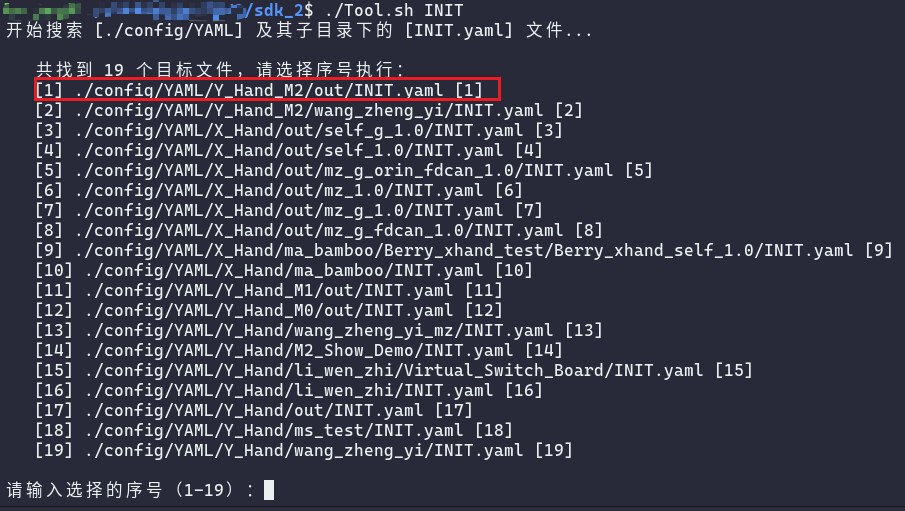
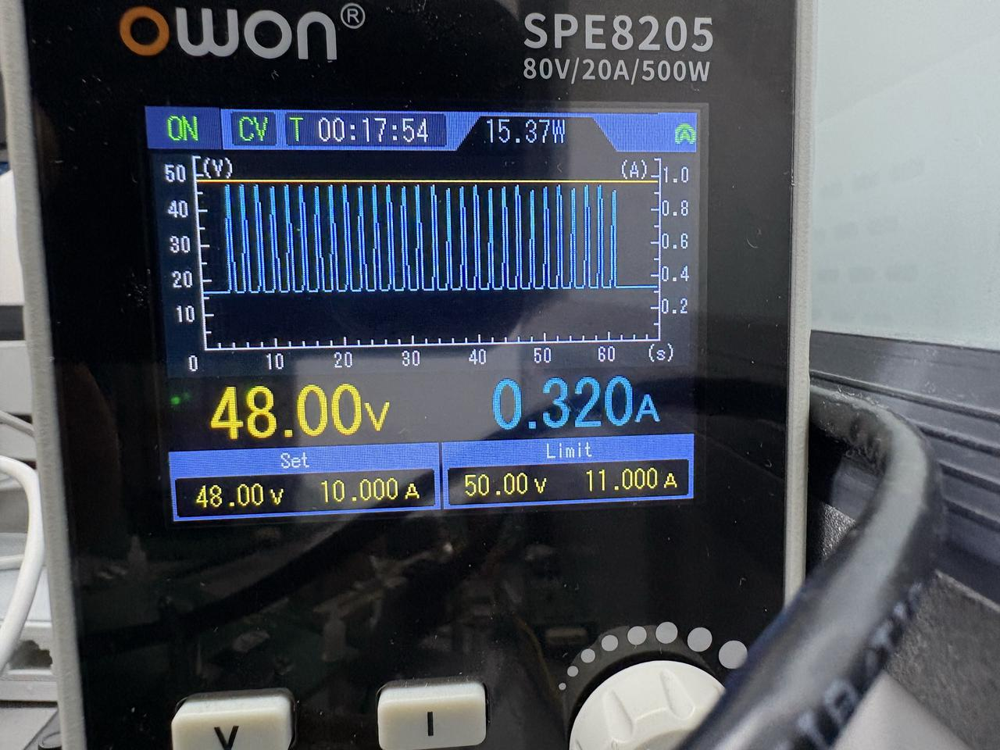

# Y_Hand_M2 

## 1. 编译
cd 到 sdk2 目录下直接调用 Tool.sh
```bash
./Tool.sh make
```

## 2. 初始化电机
用于初始化电机的零电角位置等操作
```bash
./Tool.sh INIT
```
在弹出的配置文件列表中选择 Y_Hand_M2 out(如下图选1):



> 注意<br>
> 电机初始化时会有电流尖峰，如下图蓝色波形，每台电机一个尖峰，如果中间某个电机没有这个尖峰，则需检查电机是否正常。




 ## 3. 预紧
预紧过程为纯电流环驱动。预紧过程开始后会在终端打印出每个电机的位置、速度等参数，此时每台电机的最大扭矩恒定，可手动将手指扳到预定初始位置。<br>
预紧过程如下：
<br>

首先，执行 bin 目录下的预紧程序：
```bash
cd bin
./hand_pretighten_m2
```
<br>
第二，待预紧开始后手动将Y_Hand手指扳到预定初始位置。
<br>

第三，按下键盘Esc键，此时程序自动将当前电机位置设置为零点，并存入多圈计数flash中。
> 注意这一步完成后会继续打印电机当前位置、速度信息，在此之前不要停止程序、不要下电。
<br>
最后，将Y_Hand重新上电，到此预紧完成
<br>

## 4. 手自动回零
预紧完成后，已经可以在下电时记录电机位置，再次上电执行out可执行程序`./Y_Hand_M2_Demo`时，手会自动回到预紧时设置的初始位置。


